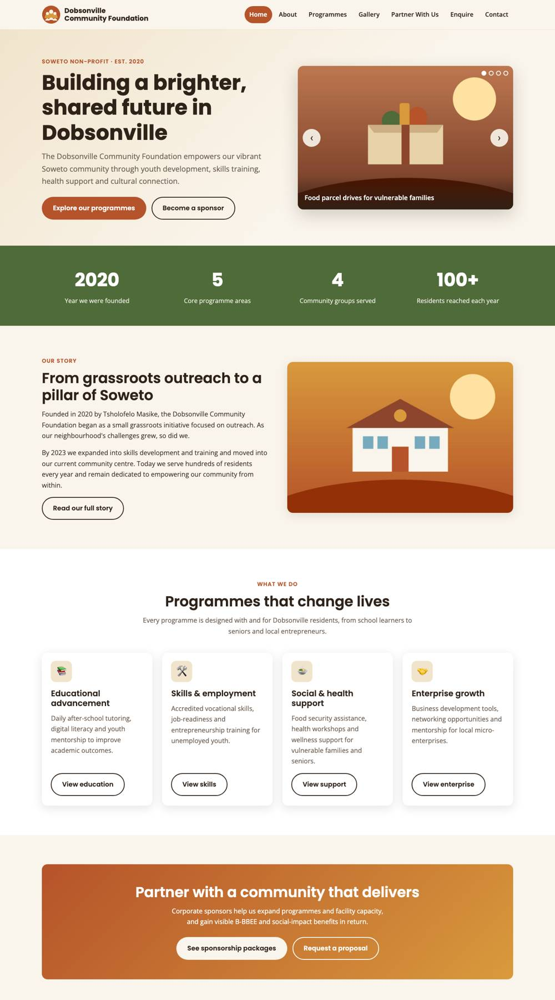
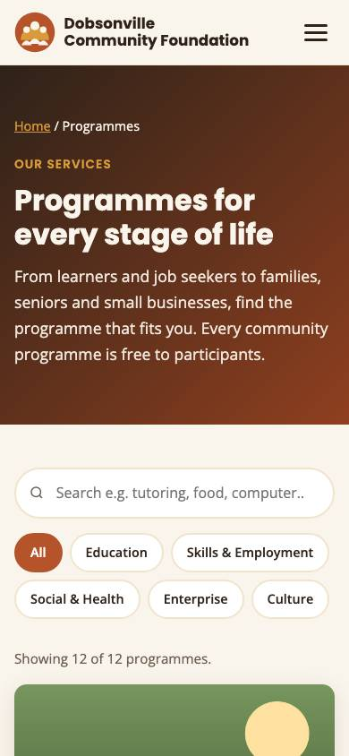
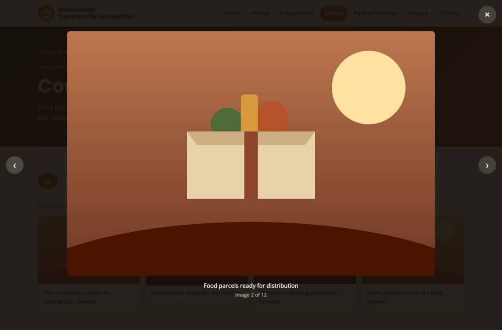
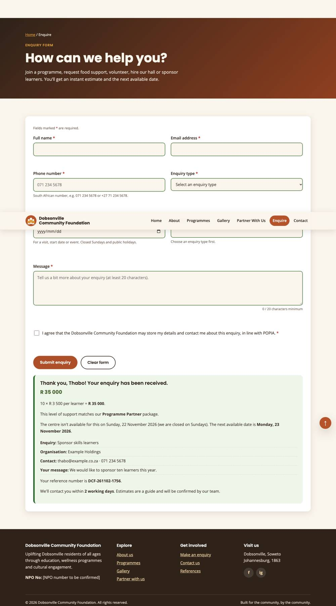
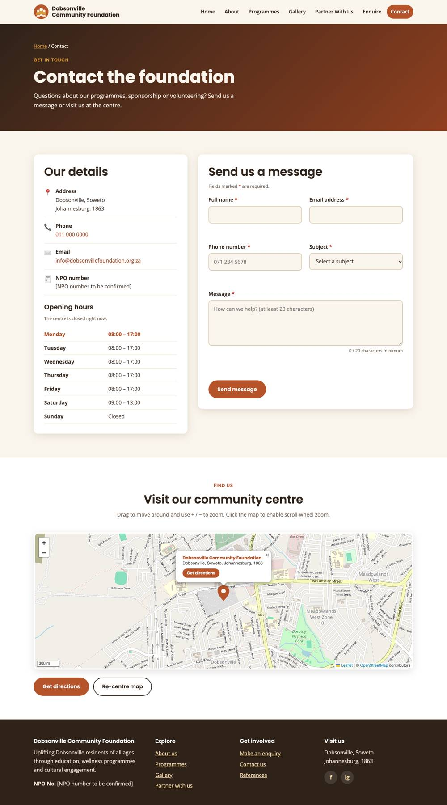

# Dobsonville Community Foundation Website

A responsive, multi-page website for the **Dobsonville Community Foundation**, a non-profit organisation in Dobsonville, Soweto, that empowers residents through youth development, skills training, health support and cultural connection.

**Live site:** https://the-developer-tong.github.io/dobsonville-community-foundation/ *(available after GitHub Pages is enabled; see [Deployment](#deployment))*

---

## Table of contents

1. [Project overview](#project-overview)
2. [Purpose and goals](#purpose-and-goals)
3. [Pages](#pages)
4. [Features](#features)
5. [Technologies used](#technologies-used)
6. [Project structure](#project-structure)
7. [Setup and running locally](#setup-and-running-locally)
8. [How the forms and email work](#how-the-forms-and-email-work)
9. [Updating content](#updating-content)
10. [SEO](#seo)
11. [Accessibility](#accessibility)
12. [Testing](#testing)
13. [Deployment](#deployment)
14. [Screenshots](#screenshots)
15. [Changelog](#changelog)
16. [References](#references)
17. [Author](#author)

---

## Project overview

Founded in 2020 by Tsholofelo Masike, the Dobsonville Community Foundation began as a grassroots outreach initiative. By 2023 it had expanded into skills development and training and moved into its own community centre. Before this project the foundation had **no website** and relied on Facebook, Instagram and word of mouth, which limited its reach to sponsors, vulnerable families and unemployed youth.

This website gives the foundation a trustworthy online home that:

- tells its story, mission, vision and goals,
- showcases its programmes and impact,
- makes it easy for **corporate sponsors** to understand packages and get in touch,
- lets residents enquire about programmes, food parcels and volunteering.

**Mission:** To uplift Dobsonville residents of all ages through education, wellness programmes and cultural engagement, building a stronger, more self-sustaining community together.

**Vision:** A united, prosperous and empowered Dobsonville for all.

## Purpose and goals

The site is designed around the foundation's key performance indicators:

| KPI | How the website supports it |
| --- | --- |
| Awareness and unique reach | SEO-optimised pages, Open Graph tags for social sharing, clear About and Impact content |
| Sponsor proposal inquiries | Partner With Us page, "Request a proposal" calls to action, enquiry form with sponsorship estimates |
| Sponsorship conversion rate | Clear tiered packages, instant cost estimates, low-friction contact form |

## Pages

| Page | File | Description |
| --- | --- | --- |
| Home | `index.html` | Hero with image slider, impact counters, story, programme overview, sponsor call to action |
| About | `about.html` | History timeline, mission, vision, founder, goal tabs, audience, FAQ accordion |
| Programmes | `services.html` | Programmes rendered from JavaScript data with live search and category filters |
| Gallery | `gallery.html` | Filterable image grid with a full-featured lightbox |
| Partner With Us | `partner.html` | Why partner, sponsorship tiers, ways to give (tabs), partner showcase |
| Enquire | `enquiry.html` | Enquiry form with validation, cost/availability calculation and summary |
| Contact | `contact.html` | Contact details, live opening hours, email contact form, interactive map |
| References | `references.html` | Harvard-style list of all sources, libraries and tools |
| 404 | `404.html` | Friendly "page not found" page served by GitHub Pages |

## Features

### Interactive elements
- **Responsive hamburger menu** with animated icon; closes on link click, Esc or outside click.
- **Homepage image slider** with autoplay, previous/next buttons, dots, arrow keys, and pause on hover/focus (autoplay off for users who prefer reduced motion).
- **Animated impact counters** that count up when scrolled into view.
- **Accessible tabs** (About goals, Partner ways-to-give) with arrow/Home/End key support.
- **FAQ accordion** that keeps one answer open at a time.
- **Scroll-reveal animations**, sticky header shadow and a **back-to-top button**.
- **Live opening hours** that highlight today and show whether the centre is open now.
- Deep links such as `services.html?category=skills` and `enquiry.html?type=sponsorship` pre-select filters and form options.

### Interactive map
- **Leaflet.js** map with **OpenStreetMap** tiles centred on Dobsonville, Soweto.
- Branded marker with a popup showing name, address and a **Get directions** link (Google Maps).
- Zoom, pan and scale bar; scroll-wheel zoom only after clicking the map so it doesn't hijack page scrolling.
- "Re-centre map" button and a text fallback if the map library fails to load.

### Gallery lightbox
- Responsive grid of lazy-loaded (`loading="lazy"`), compressed images with captions.
- Lightbox with enlarged image, caption, image counter, **next/previous**, **close**, **Esc**, **arrow keys**, **swipe** on touch screens and **click-outside-to-close**.
- Focus is trapped inside the lightbox and returned to the thumbnail on close.
- Category filters; the lightbox only cycles through the currently visible photos.

### Dynamic content and search
- All programmes are stored in a JavaScript array (`js/data.js`) and rendered into the page.
- **Live, case-insensitive search** across title, description, audience, schedule and keywords; multi-word searches match all words.
- Matching text is **highlighted**, a live result count is announced to screen readers, and a friendly **no-results** message offers a reset button.
- **Category filter buttons** generated from the data.

### Enquiry form (`enquiry.html`)
- Fields: full name, email, phone, enquiry type (dropdown), programme (shown when relevant), organisation (optional, shown when relevant), preferred date, number of people/items, message and POPIA consent checkbox.
- **Validation of every field**, in real time on blur and while typing:
  - name: letters only, name and surname,
  - email format,
  - **South African phone format** (`0XX XXX XXXX` or `+27 XX XXX XXXX`),
  - date not in the past and within 12 months,
  - whole-number quantity within limits that change per enquiry type,
  - message at least 20 characters (with live character counter),
  - consent must be ticked.
- **Processing and response:** on a valid submit the page shows a personalised summary with a **calculated result**:
  - sponsor learners: R3 500 × learners, plus the matching sponsorship tier,
  - fund food parcels: R450 × parcels and number of people fed,
  - food parcel request: parcels needed for the household size,
  - volunteering: total volunteer hours,
  - hall hire: rate based on guest numbers,
  - **availability**: checks Sundays, Saturdays, SA public holidays and notice periods, and suggests the next available date,
  - a unique reference number (e.g. `DCF-261102-4821`).
- The form then clears. If email is configured, a copy is also sent to the foundation via Formspree.

### Contact form (`contact.html`)
- Fields: name, email, phone, subject (dropdown) and message, with the same validation standard.
- **Sends a real email through Formspree** with a loading spinner, a success message and a clear error message if sending fails (entered details are kept so the visitor can retry).
- Hidden honeypot field to block spam bots.

## Technologies used

- **HTML5**: semantic structure (`header`, `nav`, `main`, `section`, `article`, `aside`, `footer`)
- **CSS3**: custom properties, Flexbox, Grid, media queries, transitions; no framework
- **Vanilla JavaScript (ES6+)**: no frameworks
- **Leaflet 1.9.4** + **OpenStreetMap**: interactive map
- **Formspree**: form-to-email service for a static site
- **Google Fonts**: Poppins (headings) and Open Sans (body)
- **Git and GitHub**: version control; **GitHub Pages**: hosting
- **Visual Studio Code**: code editor

## Project structure

```
├── index.html            Home
├── about.html            About us
├── services.html         Programmes (dynamic + search)
├── gallery.html          Gallery + lightbox
├── partner.html          Partner With Us / sponsorship
├── enquiry.html          Enquiry form
├── contact.html          Contact form + map
├── references.html       References
├── 404.html              Not-found page
├── css/
│   └── style.css         All site styles
├── js/
│   ├── main.js           Shared interactions (nav, slider, tabs, accordion, counters…)
│   ├── data.js           Programme data rendered on services.html
│   ├── services.js       Programme rendering, search and filters
│   ├── gallery.js        Gallery filters and lightbox
│   ├── config.js         Formspree endpoint (edit this)
│   ├── validation.js     Reusable validation rules and Formspree sender
│   ├── enquiry.js        Enquiry form logic and calculations
│   ├── contact.js        Contact form logic
│   └── map.js            Leaflet map
├── images/               Compressed, descriptively named images + logo
├── docs/screenshots/     Screenshots used in this README
├── CHANGELOG.md          Dated development history
└── .nojekyll             Tells GitHub Pages to serve files as-is
```

## Setup and running locally

No build step or install is needed.

1. Clone the repository:
   ```bash
   git clone https://github.com/The-Developer-Tong/dobsonville-community-foundation.git
   cd dobsonville-community-foundation
   ```
2. Open the site with a local server. Opening the HTML file directly also works, but a server matches how GitHub Pages behaves:
   - **VS Code:** install the *Live Server* extension, right-click `index.html` and choose **Open with Live Server**, or
   - **Python:** run `python3 -m http.server 8000` and visit http://localhost:8000.
3. To make the forms send email, follow the next section.

## How the forms and email work

Both forms validate in the browser with JavaScript (`js/validation.js`). Emails are sent through **[Formspree](https://formspree.io/)**, which receives the form data and forwards it to the foundation's inbox. No server code is required.

### Setting up Formspree (about 5 minutes)

1. Create a free account at https://formspree.io/ using the foundation's email address.
2. Click **+ New Form**, name it "Dobsonville website", and confirm the email address it should send to.
3. Copy the form **endpoint**. It looks like `https://formspree.io/f/xayzabcd` (the part after `/f/` is your **Form ID**).
4. Open `js/config.js` and replace the placeholder:
   ```js
   const SITE_CONFIG = {
     formspreeEndpoint: "https://formspree.io/f/xayzabcd"
   };
   ```
5. Commit and push. Submit the contact form once on the live site and confirm the first submission in your inbox (Formspree asks you to verify the first one).
6. Optional: in Formspree's form settings, add your GitHub Pages domain under **Restrict to domain** to block misuse.

**That's the only key needed.** There is no secret key in the code. The free plan allows 50 submissions per month.

Until the endpoint is set, the contact form shows a clear "email service has not been set up yet" error, and the enquiry form still shows its full summary and estimate.

## Updating content

- **Programmes:** edit the `PROGRAMMES` array in `js/data.js`. Each entry has a title, category, audience, schedule, description, search keywords and image. The Programmes page and the enquiry dropdown update automatically.
- **Pricing used in estimates:** edit `ENQUIRY_TYPES` in `js/enquiry.js` (`unitCost`, limits and notice periods).
- **Map location:** edit `CENTRE` (latitude/longitude and address) at the top of `js/map.js`.
- **Images:** replace files in `images/` with real photos **using the same file names**, or update the paths and `alt` text in the HTML.

## SEO

- A unique `<title>` (49–60 characters) on every page, including the foundation name and main keyword.
- A unique meta description (150–160 characters) on every page, matched to page content.
- Tailored meta keywords per page (5 relevant phrases, no stuffing).
- Open Graph and Twitter card tags for link previews on Facebook and WhatsApp.
- `lang="en-ZA"`, viewport meta, semantic HTML5 and exactly one `<h1>` per page.
- Descriptive, hyphenated image file names (e.g. `dobsonville-food-parcel-drive.jpg`) and meaningful `alt` text on every image.
- Images compressed to about 15–40 KB, with explicit width/height to prevent layout shift and lazy loading below the fold.

## Accessibility

- Skip-to-content link, visible focus outlines and keyboard support for every interactive element.
- ARIA patterns for tabs, accordion, carousel, dialog (lightbox) and live regions.
- Every form control has a `<label>`; errors are linked with `aria-describedby`, flagged with `aria-invalid` and announced via `aria-live`.
- Respects `prefers-reduced-motion`.
- Colour palette chosen for readable contrast.

## Testing

The site was tested in Chrome at desktop (1366 px) and mobile (390 px) widths with an automated browser script and manual checks:

- ✅ All 9 pages load with **no console errors, no failed requests and no broken images**
- ✅ No horizontal scrolling on mobile
- ✅ All internal links and relative file paths resolve
- ✅ Hamburger menu opens and closes (button, link, Esc)
- ✅ Programme search: case-insensitive, highlights matches, no-results message, category filters and deep links
- ✅ Lightbox: open, next, previous, arrow keys, Esc, click-outside, gallery filters
- ✅ Enquiry form: every validation rule, estimate calculations, Sunday → Monday availability, form clears
- ✅ Contact form: validation, unconfigured-email error message, success path (mocked Formspree response) and form clears
- ✅ Map tiles, marker and popup load

## Deployment

The site is hosted on **GitHub Pages**:

1. Create a new public repository on GitHub named `dobsonville-community-foundation`.
2. Push the code:
   ```bash
   git remote add origin https://github.com/The-Developer-Tong/dobsonville-community-foundation.git
   git push -u origin main
   ```
3. On GitHub, open **Settings → Pages**. Under **Build and deployment**, choose **Deploy from a branch**, select **main** and **/ (root)**, then click **Save**.
4. After 1–2 minutes the site is live at `https://the-developer-tong.github.io/dobsonville-community-foundation/`.
5. Update the live link at the top of this README if the URL differs.

## Screenshots

| Home (desktop) | Programmes search (mobile) |
| --- | --- |
|  |  |

| Gallery lightbox | Enquiry estimate |
| --- | --- |
|  |  |

| Contact page and map |
| --- |
|  |

## Changelog

The full dated history is in [CHANGELOG.md](CHANGELOG.md). Summary:

| Date | Version | Changes |
| --- | --- | --- |
| 2026-11-02 | 0.1.0 | Original draft homepage and stylesheet (baseline) |
| 2026-11-02 | 0.2.0 | New design system, logo and compressed descriptive images |
| 2026-11-02 | 0.3.0 | Homepage rebuild, shared interactions (nav, slider, counters, back-to-top) |
| 2026-11-02 | 0.4.0 | About page (timeline, tabs, FAQ accordion) |
| 2026-11-02 | 0.5.0 | Programmes page with dynamic data, live search and filters |
| 2026-11-02 | 0.6.0 | Gallery with lightbox |
| 2026-11-02 | 0.7.0 | Partner With Us page |
| 2026-11-02 | 0.8.0 | Enquiry form with validation and estimates |
| 2026-11-02 | 0.9.0 | Contact form with Formspree and Leaflet map |
| 2026-11-02 | 0.10.0 | References and 404 pages |
| 2026-11-02 | 0.11.0 | Bug fixes from browser testing, SEO title tuning |
| 2026-11-02 | 1.0.0 | README, changelog and deployment preparation |

## References

Harvard style. The same list appears on the website's [References page](references.html).

**Content**
- Dobsonville Community Foundation (2026) *Organisational overview and website proposal*. Unpublished internal document. Johannesburg: Dobsonville Community Foundation.

**Images**
- All images are original placeholder illustrations created by the developer with Pillow for this project. They will be replaced by photographs supplied by the foundation.

**Libraries, services and data**
- Agafonkin, V. and Leaflet contributors (2023) *Leaflet: an open-source JavaScript library for interactive maps* (Version 1.9.4). Available at: https://leafletjs.com/ (Accessed: 2 November 2026).
- OpenStreetMap contributors (2026) *OpenStreetMap*. Available at: https://www.openstreetmap.org/copyright (Accessed: 2 November 2026).
- Formspree (2026) *Formspree: form backend for static websites*. Available at: https://formspree.io/ (Accessed: 2 November 2026).
- Google (2026) *Google Fonts: Poppins and Open Sans*. Available at: https://fonts.google.com/ (Accessed: 2 November 2026).
- unpkg (2026) *unpkg: a fast, global content delivery network for npm packages*. Available at: https://unpkg.com/ (Accessed: 2 November 2026).

**Tutorials and documentation**
- Leaflet (2023) *Leaflet quick start guide*. Available at: https://leafletjs.com/examples/quick-start/ (Accessed: 2 November 2026).
- MDN Web Docs (2026) *Client-side form validation*. Available at: https://developer.mozilla.org/en-US/docs/Learn/Forms/Form_validation (Accessed: 2 November 2026).
- MDN Web Docs (2026) *Intersection Observer API*. Available at: https://developer.mozilla.org/en-US/docs/Web/API/Intersection_Observer_API (Accessed: 2 November 2026).
- W3C Web Accessibility Initiative (2024) *ARIA Authoring Practices Guide: Tabs pattern*. Available at: https://www.w3.org/WAI/ARIA/apg/patterns/tabs/ (Accessed: 2 November 2026).
- W3C Web Accessibility Initiative (2024) *ARIA Authoring Practices Guide: Accordion pattern*. Available at: https://www.w3.org/WAI/ARIA/apg/patterns/accordion/ (Accessed: 2 November 2026).
- Formspree (2026) *Submit with AJAX*. Available at: https://help.formspree.io/hc/en-us/articles/360013470814-Submit-forms-with-JavaScript-AJAX- (Accessed: 2 November 2026).
- GitHub (2026) *Creating a GitHub Pages site*. Available at: https://docs.github.com/en/pages/getting-started-with-github-pages/creating-a-github-pages-site (Accessed: 2 November 2026).

**Tools**
- Anthropic (2026) *Claude* (Claude Opus 5.5) [Large language model]. Used to help plan, write and debug the HTML, CSS and JavaScript code. Available at: https://claude.ai/ (Accessed: 2 November 2026).
- Clark, A. and Pillow contributors (2025) *Pillow* (Version 11.3.0) [Python imaging library]. Available at: https://python-pillow.org/ (Accessed: 2 November 2026).
- Microsoft (2026) *Visual Studio Code* [Code editor]. Available at: https://code.visualstudio.com/ (Accessed: 2 November 2026).

## Author

- **Developer:** Tsholofelo Masike (ST10507323)
- **GitHub:** [@The-Developer-Tong](https://github.com/The-Developer-Tong)
- **Email:** tongmoarabi@gmail.com
- **Module:** [Module name and code], WEDE Part 2
- **Client:** Dobsonville Community Foundation, Dobsonville, Soweto

© 2026 Dobsonville Community Foundation.
